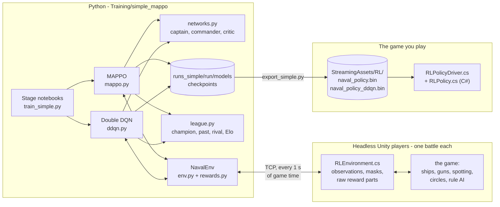
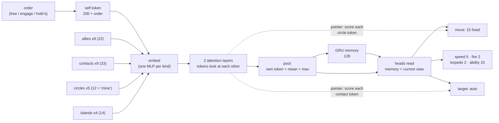
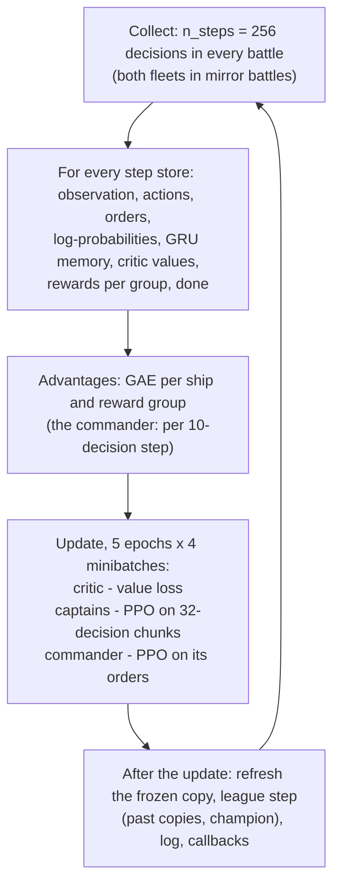
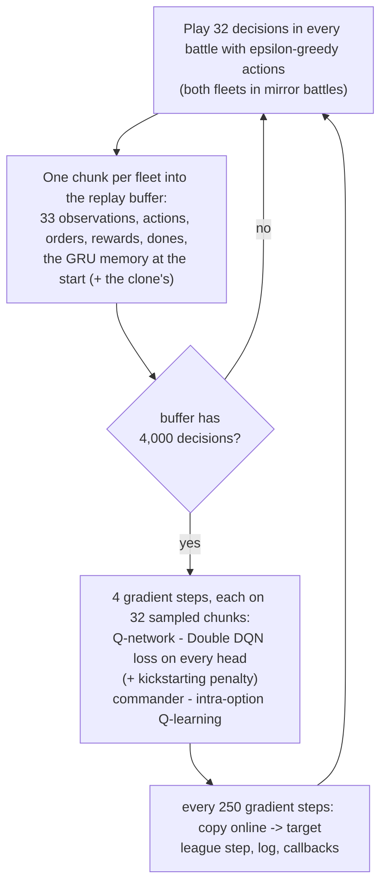
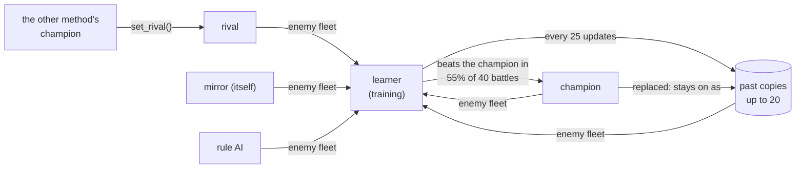

# The fleet's AI — MAPPO and Double DQN with a fleet commander

This package trains the warships of the Unity naval game to fight as a fleet, with two
reinforcement-learning methods built from the **same parts**, so they can be compared stage by stage:

- **MAPPO** — Multi-Agent PPO, a *policy-gradient* method (the PPO of Week 10, for a team);
- **Double DQN** — a *value-based* method (the DQN of Week 9, for a team).

Every ship is steered by the same **captain** network, a **fleet commander** gives the ships orders
every 10 seconds, and both learn through a **nine-stage curriculum** — from sinking a target that
does not shoot back to a 9v9 battle over five capture circles — against the game's rule-based AI,
against themselves, and against each other. The trained fleets are exported to the game, which runs
them in plain C# with no Python.

**Start here:** the notebooks [`StageP-Imitation.ipynb`](../StageP-Imitation.ipynb), then
[`Stage0-Gunnery.ipynb`](../Stage0-Gunnery.ipynb) … [`Stage8-Archipelago-9v9.ipynb`](../Stage8-Archipelago-9v9.ipynb).
Each stage notebook trains both methods on its stage and compares them.

---

## Contents

1. [The short version](#1-the-short-version)
2. [The game as a reinforcement-learning problem](#2-the-game-as-a-reinforcement-learning-problem)
3. [The reward](#3-the-reward)
4. [The networks (shared by both methods)](#4-the-networks-shared-by-both-methods)
5. [Imitation: the warm start both methods share](#5-imitation-the-warm-start-both-methods-share)
6. [MAPPO — how it learns](#6-mappo--how-it-learns)
7. [Double DQN — how it learns](#7-double-dqn--how-it-learns)
8. [MAPPO and Double DQN side by side](#8-mappo-and-double-dqn-side-by-side)
9. [The curriculum](#9-the-curriculum)
10. [Self-play and the league](#10-self-play-and-the-league)
11. [Training it](#11-training-it)
12. [Playing it in Unity](#12-playing-it-in-unity)
13. [Files](#13-files)
14. [Results so far](#14-results-so-far)
15. [Speed](#15-speed)
16. [Troubleshooting](#16-troubleshooting)
17. [References and course links](#17-references-and-course-links)

> Diagrams use [Mermaid](https://mermaid.js.org/); they render on GitHub and in VS Code (with a
> Mermaid preview extension).

---

## 1. The short version

| | |
|---|---|
| **Environment** | the real Unity game (this project), built as a headless Linux player — one process per battle, many battles in parallel |
| **Agents** | every ship of our fleet (1 to 9), plus one fleet commander |
| **Decision** | every ship, every 1 s of game time: six choices (move, speed, target, fire, torpedo, ability) |
| **Commander** | every 10 s: an order for every ship — *free*, *engage*, or *hold circle k* |
| **What a ship knows** | only what its team can legally know under fog of war, as a set of *tokens* (itself, allies, spotted enemies, circles, islands) |
| **Networks** | one captain network shared by all ships: entity transformer + GRU memory + pointer heads; one commander network |
| **Method 1: MAPPO** | PPO with a centralised critic (sees the true battle, training only), GAE per reward group, dual clip |
| **Method 2: Double DQN** | dueling, branching Q-heads; Double Q-learning with n-step returns; sequence replay (R2D2); the commander as a Q-learning meta-controller |
| **Warm start** | both start from a copy of the game's Elite AI (supervised learning), kept close by a fading KL penalty |
| **Curriculum** | 9 stages, each passed at ≥ 70 % of its own goal against the rule AI |
| **Self-play** | mirror battles (both sides learn), a champion (its best self so far), past copies, and the other method's fleet (cross-play) |
| **In the game** | `naval_policy.bin` (MAPPO) and `naval_policy_ddqn.bin` (Double DQN), run by `RLPolicy.cs` |



---

## 2. The game as a reinforcement-learning problem

### 2.1 How Python and Unity talk

`NavalEnv` (`env.py`) starts `n_envs` headless copies of the game (`Builds/NavalTrainer`, built from
this project by `Training/build_player.sh`) and talks to each over TCP (`naval_rl/env.py`). It is the
same idea as `make_atari_env(n_envs=4)` in the Atari notebooks: several environments stepped together.

1. **Init** — Python tells Unity the observation sizes (room for 9 ships a side, 5 circles, 4
   obstacles), the decision period (1 s) and the simulation step (`sim_dt` = 0.08 s).
2. **Reset** — a battle: a scenario file (`Training/scenarios/*.json`: ships, circles, islands) or
   the settings of a generated map; who flies each fleet (Python, the rule AI, or the Elite AI being
   recorded for imitation); a random seed.
3. **Step** — Python sends six numbers for every ship of both fleets; Unity carries them out for 1 s
   of game time (12 physics frames of 0.08 s), then returns every ship's observation, the action masks and the
   raw reward parts (damage done, circles captured, ...). When a battle ends, the next one starts at
   once, like Stable-Baselines3's vector environments.

The battle runs as fast as the CPU allows — a 1v1 runs about 400× faster than real time — with the
game's own ships, gunnery, spotting, PhysX physics, capture rules and rule-based AI. Nothing is
simplified for training.

### 2.2 What a ship sees

A battle is a **set of things**, so each ship's observation is a set of **tokens**. Every token is a
row of numbers (positions are relative to the ship and turned to its heading):

| Token | How many | Numbers each | What is in it |
|---|---|---|---|
| `self` | 1 | 200 | its class, health, systems, speed, guns and reloads, every consumable (charges, cooldown), terrain rays, the score and time, the kind of battle |
| `allies` | up to 8 | 22 | each squadron mate: where, heading, health, class, what it is doing |
| `contacts` | up to 9 | 33 | each enemy **its team has spotted** — last known position, how long ago, class, threat |
| `zones` | up to 5 | 12 | each capture circle: where, how far, radius, owner (mine / theirs / neutral), capture progress, contested, am I inside |
| `obstacles` | up to 4 | 14 | the nearest islands, rocks and smoke screens: where, how big, whether they hide it from its target or from the biggest gun aimed at it |

Each kind comes with a **mask** (1 = a real token, 0 = an empty slot), so a 1v1 and a 9v9 use the
same network. Under fog of war a ship never sees what its team has not spotted. Unity sends the name
of every number (`env.spec.features`).

Two more views exist for **training only**:

- **the true battle** (`critic_own` 173, `critic_enemy` 53, `critic_zones` 10, `critic_match` 31
  numbers per token) — every ship and every enemy as they really are. MAPPO's critic reads it, and so
  does Double DQN's optional QMIX mixer;
- **the commander's view** (`fleet_enemy`, `fleet_match`) — the same with everything the team could
  not know set to zero (the enemy's true positions and strength), so the commander plays fair.

### 2.3 What a ship can do

Each decision a ship picks one option on each of six **action heads**:

| Head | Options | Meaning |
|---|---|---|
| `move` | 15 + one per circle (20) | 0 keep course · 1–8 sail a 1.5 km leg towards a compass point · 9 close in · 10 broadside · 11 open the range · 12 regroup · 13 take cover (behind land or smoke) · 14 return to port · 15 + k **sail to circle k** |
| `speed` | 5 | full · ⅔ · ⅓ · stop · astern |
| `target` | 1 + one per contact (10) | automatic, or **focus enemy contact k** |
| `fire` | 2 | fire at will · hold fire |
| `torpedo` | 2 | none · launch at the target |
| `ability` | 15 | none · one of 12 consumables (shell type, smoke, radar, hydro, repair, engine boost, ...) · dive · surface |

Illegal options are **masked** (Unity sends a mask every step): no "close in" with no enemy spotted,
no compass leg into land, no torpedo without a firing solution, no consumable that is reloading. A
masked option can never be chosen, by either method.

The game carries the choices out with its own systems — path-finding, gun lead and turret aiming,
consumables — so the network decides *what to do*, not how to steer the rudder.

### 2.4 The commander's orders

Every 10 decisions (`commander_period`) the commander gives every ship an order:

| Order | Meaning for the ship | What the reward pays it for (section 3) |
|---|---|---|
| 0 **free** | decide alone | the nearest circle that still needs a ship |
| 1 **engage** | fight; no circle duty | no circle pay |
| 2 + k **hold circle k** | go to and hold circle k | circle k |

The order reaches the captain as part of its observation: a one-hot of the order type added to its
`self` token and a "this is my circle" flag on the ordered circle's token. One-ship stages have no
commander (every ship is free).

### 2.5 Who flies the enemy

Each battle's enemy fleet is chosen by the curriculum stage (sections 9 and 10): the game's
**rule-based AI** (Recruit, Veteran or Elite), a **passive target** (Python orders it to stop and hold
fire — the first two stages), or a copy of a learned fleet (**mirror**, **champion**, **past**,
**rival**). In a *mirror* battle our own network flies both fleets and both fleets' experience is
used for training — the environment then returns two rows per battle (our fleet, then the enemy's).

---

## 3. The reward

`rewards.py` turns Unity's raw reward parts into one reward per ship per decision. It is the same for
both methods. Every term and its weight is in `REWARD_WEIGHTS` — the one place to change what the
fleet is paid for.

### 3.1 The terms

| Term | Weight | Who gets it | Group | Paid for |
|---|---|---|---|---|
| `in_circle` | +0.05 / s | the ship | objective | each second inside its circle |
| `approach_circle` | +1 / km | the ship | objective | each km sailed towards its circle (− when sailing away) |
| `zone_captured` / `zone_lost` | +1 / −1 | the fleet | objective | a circle taken / lost |
| `circles_held` | +0.05 / s | the fleet | objective | × (our circles − the enemy's) / all circles |
| `survive` | 0 (0.02 / s in Defend) | the ship | objective | each second afloat |
| `enemy_sunk` / `ship_lost` | +1 / −1 | the fleet | combat | per ship |
| `damage_dealt` / `damage_taken` | +0.5 / −0.25 | the ship | combat | per whole hull of damage |
| `friendly_fire` | −1 | the ship | combat | per whole hull done to our own side |
| `zero_sum` | 1 | the fleet | combat | minus the enemy ships' average damage terms |
| `win` / `loss` | +5 / −5 | the fleet | outcome | the result, on the last step |

`approach_circle` pays for the *change* in distance (potential-based shaping), so a ship cannot farm
it by sailing back and forth. In the Gunnery and Duel stages the circle terms are switched off — in the
duel the circle lies between the two battleships, and racing to it means sailing bow-on into the
enemy's guns.

### 3.2 Which circle a ship is paid for — spreading out

A ship ordered to hold circle k is paid for circle k; a ship ordered to engage gets no circle pay. A
**free** ship is paid for the nearest circle that **still needs a ship**: one the fleet does not own
yet, with room left. The free ships are handed out nearest pair first, and each needy circle takes at
most its share (free ships ÷ needy circles, rounded up; ships ordered there count too). With every
circle already ours, a free ship guards its nearest one.

Measured on the real start of stage 8 (9 free ships, 5 neutral circles):

| | A | B | C | D | E |
|---|---|---|---|---|---|
| paid for the *nearest* circle (before) | 2 | 0 | 0 | 0 | **7** |
| paid for the nearest circle that *needs* a ship (now) | 2 | 2 | 2 | 1 | 2 |

Together with `circles_held` — paid every second for holding more circles than the enemy, which is
how the game scores Domination — this teaches the fleet to take several circles instead of crowding
one. The commander can still send any ship anywhere.

### 3.3 Team spirit, zero-sum, reward groups

- **Team spirit** τ (OpenAI Five): each ship's own terms are blended with the fleet's average,
  `own' = (1 − τ) · own + τ · fleet average`. τ is 0 in the single-ship stages and rises
  0.3 → 0.5 → 0.8 → 1.0 from stage 4 to stage 7–8: first learn your own job, then care about the
  fleet as much as about yourself.
- **Zero-sum** (OpenAI Five): what the enemy ships earn in combat is subtracted, so dealing damage and
  not taking it count the same.
- **Reward groups** (Honor of Kings): the terms fall into three groups — objective, combat, outcome.
  MAPPO's critic predicts each group's return separately (three easier predictions instead of one hard
  one); the logs show what the fleet is actually earning (`plot_reward_terms`).

---

## 4. The networks (shared by both methods)

`networks.py`. MAPPO and Double DQN use the **same captain and commander networks**; only what their
outputs mean, and how they are trained, differ.

### 4.1 The entity encoder

Each kind of token gets its own small MLP (embedding, width 64); then **two transformer layers**
(4 attention heads) let every token look at every other real token — padding is masked out; then the
tokens are **pooled** (mean and max over the real ones). It is the job the custom CNN feature
extractor did for Atari frames in Week 10, done for a set of things instead of a picture
(AlphaStar: transformer over units; OpenAI Five: max-pooling over units).

### 4.2 The captain — every ship, one shared network



- **Memory (GRU, 128)**: under fog of war an enemy that slipped out of sight is still somewhere. The
  GRU is a learned version of Atari's frame stacking (OpenAI Five uses an LSTM). It is cleared at the
  start of every battle.
- **Heads read the memory *and* the current view**, so reacting to what is in front of the ship does
  not have to pass through the memory first.
- **Pointer heads** (AlphaStar; Honor of Kings' target attention): "which enemy to target" and "which
  circle to sail to" are scored directly against the contact and circle tokens, so 1 or 9 enemies use
  the same layer, and the network does not depend on how many slots the observation has.
- What the outputs **mean**: for MAPPO they are *logits* (probabilities after a softmax); for Double
  DQN they are *advantages* of a Q-function (section 7.3).

### 4.3 The commander

It reads the fleet's view — its own ships (true state), the enemies as the team believes them to be,
the circles and the match — with its own entity encoder, then scores, for every ship, *free*,
*engage* and *hold circle k* (a pointer over the circle tokens). It starts out biased towards
"free", so the captains decide until the commander has learned something better. This is the
macro/micro split of Tencent's Hierarchical Macro Strategy model: the commander decides **where** the
fleet should be, the captains decide **how** to fight there.

### 4.4 Method-specific parts

| | MAPPO | Double DQN |
|---|---|---|
| Extra network | **centralised critic**: the true battle → for every ship a value per reward group, the commander's value and the chance of winning | **value stream** V(s) for every ship (one number), and an optional **QMIX mixer** |
| Used in the game? | no (training only) | no (training only) |

### 4.5 Sizes

| Network | Parameters |
|---|---|
| captain (shared by all ships) | 234,024 |
| commander | 126,018 |
| MAPPO critic | 121,989 |
| Double DQN value stream | 193 |

All of it runs on a CPU; no GPU is needed for training or in the game.

---

## 5. Imitation: the warm start both methods share

A random policy almost never wins a naval battle, so RL from scratch spends most of its time
discovering "sail, aim, shoot". AlphaStar solved this by first copying human players with supervised
learning, then improving with RL. We copy the game's **Elite rule-based AI** (`imitation.py`, the
`StageP-Imitation` notebook):

1. **Record** — the Elite AI flies both fleets in battles of stages 2–6; for every decision of every
   one of our ships the game reports the option it chose on each head (`RLExpertLabels.cs`). That is a
   labelled dataset: observation → action (~100k decisions in 60–70 battles).
2. **Clone** — train the captain to predict those labels: Week 9 Part A again — a `DataLoader`, one
   `CrossEntropyLoss` per head, `Adam`, loss and accuracy curves — on windows of 32 consecutive
   decisions so the GRU learns too. Held-out accuracy: move 0.72, speed 0.89, target 0.91, fire 0.95.
3. **Hand over** — `models/imitation.pt` starts **both** methods (section 6.6 and 7.9), each with a
   fading penalty that keeps it close to the clone while its own learning signal is still weak.

The clone alone already passes Capture (100 %) and King of the Hill against Veteran (83 %).

---

## 6. MAPPO — how it learns

`mappo.py`, class `MAPPO`. It is the PPO of Week 10 — collect experience with the current policy,
compute advantages, a few epochs of clipped updates, repeat — for a team, with a commander.

### 6.1 The idea

- **Policy gradient**: the captain outputs a probability for every option; options that turned out
  *better than expected* become more likely, worse ones less likely.
- **"Better than expected"** needs an expectation: a **critic** predicts the return from each state.
- **Centralised training, decentralised execution** (MAPPO): every ship acts on its own fogged view
  with the shared captain; the critic, used only in training, sees the **true** battle, so its
  predictions — and so the learning signal — are much less noisy. The trained fleet never needs the
  critic, so it still plays fair.

### 6.2 One update, step by step



1. **Collect.** For `n_steps` = 256 decisions in every battle, the commander (every 10 decisions)
   and every ship's captain act; the critic scores every state; `rewards.py` computes each ship's
   reward per group. With 8 battles that is 2,048 battle-decisions per update.
2. **Advantages** (6.3, 6.4).
3. **Update** — 5 epochs over the data, each split into 4 minibatches (a fixed *count*, so a 1v1 and a
   9v9 get the same number of gradient steps): the critic (6.5), the captains (6.4), the commander.
4. **Between updates** — the frozen "latest" copy is refreshed every 10 updates, past copies and the
   champion are handled by the league (section 10), a row is written to `logs/progress.csv`, and the
   callbacks run (promotion, checkpoints, best model, replays, team sync).

### 6.3 Advantages: GAE, per reward group

Generalised Advantage Estimation (Week 10), computed backwards in time for every ship slot and every
reward group g:

```
delta_t     = r_t(g) + gamma * V_g(s_t+1) * (1 - done_t) - V_g(s_t)
A_t(g)      = delta_t + gamma * lambda * (1 - done_t) * A_t+1(g)          gamma 0.995, lambda 0.95
return_t(g) = A_t(g) + V_g(s_t)                                           the critic's target
A_t         = A_t(objective) + A_t(combat) + A_t(outcome)                 what the captain learns from
```

γ = 0.995 looks about 200 decisions (200 s) ahead — battles are long. The advantages are normalised
(mean 0, std 1) over the live ship-decisions of the update.

**The commander's advantage** — its step lasts 10 decisions, so it is a semi-Markov decision: its
reward is the fleet's average reward summed (discounted) over those 10 decisions, and it bootstraps
from the critic's *commander value* 10 decisions later:

```
R_k   = sum_{j<10} gamma^j * (fleet's average reward at t_k + j)
A_k   = R_k + gamma^10 * V_cmd(s_t_k+1) - V_cmd(s_t_k) + gamma^10 * lambda * A_k+1
```

### 6.4 The captain's loss: clipped PPO with a dual clip

For every ship-decision, with `ratio = pi_new(a|s) / pi_old(a|s)` (the product over the six heads):

```
surrogate = min( ratio * A,  clip(ratio, 1 - 0.2, 1 + 0.2) * A )                  PPO (Week 10)
if A < 0:  surrogate = max( surrogate, 3 * A )                                    dual clip (Honor of Kings)
loss      = - mean(surrogate) - ent_coef * entropy + kl_coef * KL(clone || pi)
```

- **The clip** keeps one update from moving the policy too far.
- **The dual clip**: with a negative advantage and a huge ratio, PPO's objective has no lower bound;
  bounding it at 3·A means one very stale sample cannot blow up an update.
- **Entropy bonus**: 0.01, fading to 0.002 over 1,500 updates — explore early, commit later
  (`ent_coef="auto"` tunes it like SAC's, Week 10).
- **KL anchor**: after the imitation start, `0.1 · KL(clone ‖ policy)`, fading to 0.01 over 1,000
  updates (AlphaStar). For the first 10 updates only the critic trains, so it catches up before the
  policy moves.
- **Death masking** (MAPPO): a sunk ship's decisions no longer train the captain.

The commander is trained the same way on its orders, with the fleet's orders as **one joint decision**
(its ratio is the product over the fleet's ships, like TiZero's joint-ratio policy optimisation).

### 6.5 The critic's loss

```
loss = 0.5 * [ mean over ships and groups of max( (V - y)^2, (V_clipped - y)^2 )     value clipping 0.2
             + (V_cmd - y_cmd)^2  on the commander's decisions
             + 0.25 * BCE(win logit, battle won) ]                                    win probability
```

The targets y are **normalised** (MAPPO's value normalisation: a running mean and std per reward group,
with the paper's slow β = 0.99999 — a fast one moved the targets every update and stalled learning).
A sunk ship's critic keeps learning, because team rewards keep arriving until the battle ends.

### 6.6 Memory: training on chunks

The captain has a GRU, so it is trained on **chunks of 32 consecutive decisions** of one ship: each
chunk starts from the memory the ship had at that point of the rollout (stored during collection) and
replays the chunk through the GRU, clearing it where a new battle starts (recurrent MAPPO).

### 6.7 MAPPO settings (the notebooks' `mappo_settings`)

| Setting | Value | What it does |
|---|---|---|
| `learning_rate` / `critic_learning_rate` / `commander_learning_rate` | 3e-4 / 5e-4 / 1e-4 | Adam step sizes |
| `n_steps` | 256 | decisions per battle per update |
| `n_minibatches` × `n_epochs` | 4 × 5 | gradient steps per update |
| `gamma`, `gae_lambda` | 0.995, 0.95 | discount, GAE |
| `clip_range`, `dual_clip`, `value_clip` | 0.2, 3.0, 0.2 | PPO clips |
| `ent_coef` | 0.01 → 0.002 | exploration bonus |
| `kl_bc_coef` | 0.1 → 0.01 | the pull towards the imitation clone |
| `chunk_len` | 32 | decisions per training chunk (GRU) |
| `d_model`, `attn_layers`, `hidden_size` | 64, 2, 128 | network sizes |
| `commander_period` | 10 | decisions between the commander's orders |
| `opponent_refresh`, `snapshot_every` | 10, 25 updates | the frozen copy, past copies |

Ablations for a report: `centralised_critic=False` + `commander=False` is IPPO (the baseline the MAPPO
paper compares against); `recurrent=False`, `attn_layers=0`, `dual_clip=None` switch the other pieces
off (`train_simple.py --ippo --no-commander --no-memory --attn-layers 0 --dual-clip 0`).

---

## 7. Double DQN — how it learns

`ddqn.py`, class `FleetDDQN`. It is the DQN of Week 9 — a Q-network, a frozen target network, a
replay buffer, ε-greedy exploration — for a fleet with six action heads and a commander.

### 7.1 The idea

- **Q-learning**: learn Q(s, a) — the return to expect after action a in state s — and act by taking
  the action with the highest Q. No probabilities; the policy is "take the best".
- **Off-policy**: it learns from a **replay buffer** of past experience, so every decision is used
  many times (MAPPO uses each decision for one update and throws it away).
- **Bootstrapping**: the target for Q(s, a) is the reward plus the (discounted) value of the next
  state, read from a slowly updated **target network** (Week 9 C/D).

### 7.2 One round, step by step



### 7.3 Q-values for six heads: dueling and branching

One Q-value per *complete* action would need 20 × 5 × 10 × 2 × 2 × 15 = 60,000 outputs. Instead
every head d gets its own **advantages**, sharing one **state value** (Dueling DQN + Branching DQN):

```
Q_d(s, a_d) = V(s) + A_d(s, a_d) - mean over the legal options of A_d(s, .)
```

The advantages A_d are exactly the captain network's head outputs (pointer heads included); V(s) is
the value stream (one linear layer on the same features the heads read). So **the Q-network is the
captain**, plus V. Illegal options get −∞, so the best option is always legal. Because V is the same
for every option, the best action of each head is simply the highest advantage — which is why the
game can run a Double DQN fleet with the same C# code as a MAPPO one ("greedy" in the file header).

### 7.4 The target: Double Q-learning with n-step returns, one target for all heads

**Double DQN** (van Hasselt et al.): plain DQN takes the max over the target network's own noisy
estimates and so over-estimates. Double DQN lets the **online** network *choose* the next action and
the **target** network *score* it:

```
a*_d   = argmax_a Q_online,d(s_t+n, a)                          per head d, legal options only
next   = mean over heads d of Q_target,d(s_t+n, a*_d)            one value for the next state (BDQ)
y_t    = r_t + gamma r_t+1 + ... + gamma^(n-1) r_t+n-1 + gamma^n * next * (1 - battle ended)
loss   = mean over heads d of Huber( Q_online,d(s_t, a_t,d) - y_t )
```

- **n-step returns** (n = 5, as R2D2): rewards of the next 5 decisions plus the bootstrap, so a
  reward reaches the Q-values of earlier decisions faster. The sum stops at the end of a battle; at the
  end of a chunk the bootstrap comes earlier.
- **One target for every head** (Branching DQN): every head is trained towards the same y, so each
  head gets a full-sized learning signal. (An earlier version trained the *average* of the heads'
  Q-values: each head then got a sixth of the signal and learned far more slowly.)
- **Huber loss** and gradient clipping at 10, as in DQN.
- γ = 0.99 (DQN's usual; MAPPO uses 0.995 with GAE).

### 7.5 Sequence replay (R2D2)

The captain has a GRU, so the buffer stores **sequences**, not single transitions (R2D2,
Kapturowski et al.): every 32 decisions each fleet adds a **chunk** of 33 observations (the last is
only there to bootstrap from, and is also the first of the next chunk), the actions, orders, rewards
and battle ends, and the **GRU memory the ships had at the chunk's start**. Training replays a chunk
through the GRU from that memory, exactly as MAPPO does with its rollout.

- Capacity: 40,000 decisions (1,250 chunks), oldest first out; sampled uniformly.
- Stored compactly: numbers as float16, masks as bytes, and only the ship slots the battle uses (a 1v1
  chunk is a ninth of a 9v9 one). About 0.6 MB per 9v9 chunk — up to ~0.8 GB when full of 9v9 battles.
- A gradient step samples 32 chunks, but at most 4,096 ship-decisions, so a 9v9 batch costs about the
  same as a 1v1 one.
- The buffer is **not saved** with the model (it would be gigabytes, and SB3 does not save it
  either); a continued session first refills it for `learning_starts` decisions.

### 7.6 Exploration: ε-greedy

While training, each ship takes its best action — or, with probability ε, a uniformly random *legal*
option on every head. ε falls linearly from 1.0 to 0.05 over 300,000 timesteps (Week 9's
`exploration_fraction`); starting from the imitation clone it starts at 0.3 instead, since random
play would only throw the clone's skill away. The commander explores with ε / 2. Evaluations,
replays and frozen opponents use ε = 0.02 (a fully greedy fleet can get stuck repeating one move);
the game uses 0.

### 7.7 The target network

A frozen copy of the Q-network (captain, value stream, commander, mixer) scores the next states, and
is overwritten with the online network every **250 gradient steps** — the target network of Week 9 C/D,
which keeps the targets from chasing themselves.

### 7.8 The commander as a Q-learner (h-DQN, intra-option learning)

The commander's scores for (ship, order) are Q-values; the value of a set of orders is their sum over
the live ships. It acts every 10 decisions, but its orders stay **in force** in between, so it learns
from every decision with **intra-option Q-learning** (Sutton, Precup & Singh; the meta-controller of
h-DQN, Kulkarni et al.):

```
Q_cmd(s, orders) = sum over live ships i of q(s, i, order_i)
U(s')            = Q_target(s', the same orders)                        if the orders stay in force
                   Q_target(s', argmax over orders of Q_online(s', .))  at the commander's next decision
y                = fleet's average reward + gamma * U(s') * (1 - battle ended)
loss             = Huber( Q_cmd(s, orders) - y )
```

### 7.9 Starting from the clone: kickstarting

The clone's head outputs reach ±10, while a decision's reward is about 1. Used as advantages
directly, the first TD updates would flatten them and erase the clone. Two things prevent it:

1. **Temperature** τ = 0.1: the starting advantages are `0.1 × the clone's scores` — the same best
   options, at the size of Q-values.
2. **Kickstarting** (Schmitt et al. 2018): a penalty `KL(clone ‖ softmax(A / τ))` on the ships' own
   replayed decisions, weight 0.5 fading to 0.05 over 20,000 gradient steps — the same idea as MAPPO's
   KL anchor.

Measured on real gunnery: without them, Double DQN fell from the clone's level to a 0.33 pass rate
within 2,400 timesteps (MAPPO with its anchor: 0.78). With them the gap to the clone stays ~0.01–0.07
nats while the Q-values form, and the pass rate went 0.50 → 0.58 in 30,000 timesteps.

### 7.10 Many ships: independent, VDN or QMIX

All ships share the Q-network. What they learn from is set by `mixer`:

| `mixer` | Each ship learns from | Fleet value |
|---|---|---|
| **`"none"` (default)** | **its own reward** (the same per-ship reward MAPPO learns from) | — |
| `"vdn"` | the fleet's average reward | Q_fleet = sum of the ships' Q |
| `"qmix"` | the fleet's average reward | Q_fleet = mix(Q_1 … Q_N, true battle) |

**QMIX** (Rashid et al.; the method of the StarCraft multi-agent challenge, still the one to beat
there once tuned — Hu et al.'s pymarl2) mixes the ships' Q-values with weights produced by small
*hypernetworks* that read the true battle. The weights are kept positive, so the fleet's value only
rises when a ship's value rises: every ship taking its own best action is also the fleet's best joint
action. It is implemented and works per head.

Why the default is `"none"`: on the mock task (rewards per ship), after 6,000 timesteps with 3 ships,
independent learning reached 0.28 accuracy and VDN 0.08 — mixing first has to work out which ship
earned the fleet's reward. It pays off only when the reward is truly shared; with team spirit 1.0
(stages 7–8) every ship's reward is the fleet's anyway, so `"qmix"` is worth an ablation there.

### 7.11 Double DQN settings (the notebooks' `ddqn_settings`)

| Setting | Value | What it does |
|---|---|---|
| `learning_rate` / `commander_learning_rate` | 2.5e-4 / 1e-4 | Adam step sizes |
| `buffer_size`, `learning_starts` | 40,000, 4,000 | replay capacity and warm-up (decisions) |
| `batch_size`, `chunk_len`, `gradient_steps` | 32, 32, 4 | chunks per step, decisions per chunk, steps per round |
| `gamma`, `n_step` | 0.99, 5 | discount, n-step return |
| `target_update_interval` | 250 | gradient steps between target-network copies |
| `exploration_*` | 1.0 → 0.05 over 300k (0.3 from the clone) | ε |
| `kl_bc_coef`, `imitation_temperature` | 0.5 → 0.05, 0.1 | kickstarting |
| `mixer` | `"none"` | `"qmix"`, `"vdn"` for comparison |
| `d_model`, `attn_layers`, `hidden_size`, `commander_period` | 64, 2, 128, 10 | the same networks as MAPPO |
| `opponent_refresh`, `snapshot_every` | 80, 200 rounds | the frozen copy, past copies (≈ MAPPO's 10, 25 updates) |

---

## 8. MAPPO and Double DQN side by side

| | MAPPO | Double DQN |
|---|---|---|
| Family | policy gradient — PPO (Week 10) | value-based — DQN (Week 9) |
| The captain's head outputs | logits: **sample** an option | advantages of a dueling Q: **take the best**, ε-greedy while training |
| Data | the battles just played (on-policy), used for 5 epochs | a replay buffer of 32-decision chunks (off-policy), each reused many times |
| Learning signal | GAE advantages from a centralised critic | Double Q targets with 5-step returns from a target network |
| Six heads | one probability per head, product for the ratio | one Q per head, every head trained to one shared target |
| Memory (GRU) | rollout replayed in 32-decision chunks | replay chunks with stored memory (R2D2) |
| Commander | PPO at a 10 s clock (semi-MDP GAE) | Q-learning on (ship, order), intra-option |
| True-battle information | the critic (training only) | optional QMIX mixer (training only) |
| Imitation start | captain = clone; KL anchor 0.1 → 0.01 | advantages = 0.1 × clone; kickstarting 0.5 → 0.05 |
| In the game | samples from the probabilities | takes the best option ("greedy") |
| Everything else | the same networks, environment, rewards, curriculum, league, callbacks, checkpoints, export | ← same |

What to expect: PPO-style methods won the big team games (OpenAI Five, Honor of Kings) and cope well
with an opponent that keeps changing; value-based methods reuse their data more and are the classic
choice for StarCraft micro-management (QMIX). Training both on identical stages is what lets the
notebooks say which one suits this game.

---

## 9. The curriculum

`curriculum.py`, `DEFAULT_CURRICULUM`. A stage is passed at **≥ 70 %** of its own goal; then the
battles change and the **same model** keeps training.

| Stage | Battle | Ships a side | Opponent | Passed when | Window |
|---|---|---|---|---|---|
| P – Imitation | Elite AI vs Elite AI, stages 2–6 | — | — | supervised: copy the Elite AI | — |
| 0 – Gunnery | 7 km, open sea | 1 BB vs 1 CA | passive target | target sunk within 150 s | 50 |
| 1 – Capture | one neutral circle | 1 CA (+ a passive DD far away) | passive | circle captured | 50 |
| 2 – Defend | neutral circle, enemy coming | 1 CA vs 1 CA | Recruit | won | 100 |
| 3 – Duel | 13 km, open sea | 1 BB | Recruit 60 % · self-play 40 % | won vs Recruit | 100 |
| 4 – King of the Hill | one circle, open sea, **commander**, τ 0.3 | 1 BB · 1 CA · 1 DD | Veteran 60 % · self-play 40 % | won vs Veteran | 100 |
| 5 – Archipelago | 3 circles among islands, τ 0.5 | 1 BB · 1 CA · 1 DD | Veteran 60 % · self-play 40 % | won vs Veteran | 150 |
| 6 – Domination | new random map and weather every 8 battles, τ 0.8 | 1 BB · 2 CA · 2 DD · 1 SS | Elite 40 % · self-play 60 % | won vs Elite | 200 |
| 7 – Open | random mode, map, weather, 4–8 ships, τ 1.0 | the game's balanced mix | Elite 40 % · self-play 60 % | won vs Elite | 200 |
| 8 – Archipelago 9v9 | **5 circles**: A B C across the middle, D up-left, E down-right; hand-placed islands; 12 min; τ 1.0 | **2 BB · 3 CA · 2 DD · 2 SS** — every class that fights | Elite 40 % · self-play 60 % | **final**: won in 70 % of 200 evaluation battles vs Elite | 200 |

Classes: BB battleship (biggest guns and armour, slow), CA cruiser (fast-firing guns, radar / hydro /
smoke support), DD destroyer (fastest, torpedoes, smoke, hardest to spot — the circle capper), SS
submarine (dives, torpedoes, very hard to spot). Every notebook lists its stage's ships by class.

- **Why the first stages are not judged on "won"**: a passive target never scores, so the game's
  tiebreak hands the win to anyone — random play "won" 100 % of them. Measured (32 battles each):
  gunnery, sunk within 150 s — random 52 %, "close in, fire, torpedoes" 76 %; capture — random 0 %,
  "sail to circle A" 100 %; defend — random 12 %, "sail to the circle" 0 %.
- **Qualifying battles** count for promotion: battles that started on the current stage against the
  stage's own opponent (the rule AI or the passive target). Self-play and rehearsal battles never
  count, and the window starts empty on every new stage. The window is rebuilt from
  `logs/monitor.csv` at the start of every session, so it carries over between sessions.
- **Rehearsal** (stages 3–8, 10–15 % of battles): an earlier stage is replayed so its skills stay —
  the stages the fleet now does worst on most often, weight `(1 − recent pass rate)² + 0.05`
  (Prioritized Level Replay). With uniform rehearsal the SageMaker run had forgotten Defend (4 %) and
  Duel (33 %) by stage 7.
- **The stopping rule** (stage 8): every 100,000 timesteps the fleet plays 40 battles against the Elite
  AI; training stops once the last 200 reach 70 %.
- **Room for 9 ships a side, 5 circles** (`MAX_SHIPS`, `MAX_ZONES` in `env.py`): a 1v1 leaves the other
  slots empty and the masks hide them. The networks read ships as tokens, so raising these limits does
  not change a single weight — the first runs had room for 8 and continue unchanged.
- **Add stages** freely: a stage is a dict (see the docstring of `curriculum.py`), e.g. a scenario file
  or generated-map settings, an opponent mix, team spirit, a pass rule.

---

## 10. Self-play and the league

`league.py`. Against one fixed opponent a policy learns to beat *that* opponent; against only its
latest self it can go round in circles (rock beats scissors beats paper beats rock). The fix used by
OpenAI Five, AlphaGo Zero and AlphaStar is a **league**:

| Opponent | Who flies the enemy | Why |
|---|---|---|
| `rule` | the game's rule AI at the stage's difficulty | the anchor: the **only** battles that count for promotion |
| `mirror` | the current network, on **both** sides, both learning | twice the data; an opponent exactly as good as the fleet (OpenAI Five) |
| `champion` | the strongest version so far | always its best self to beat (AlphaGo Zero) |
| `past` | an older copy, picked by PFSP | do not forget how to beat old strategies (AlphaStar) |
| `rival` | **the other method's fleet** (its champion, if it has one) | different training, different habits (AlphaStar's mixed league) |

| Stages | rule | mirror | champion | past | rival |
|---|---|---|---|---|---|
| 3–5 | 60 % | 15 % | 10 % | 5 % | 10 % |
| 6–8 | 40 % | 25 % | 10 % | 15 % | 10 % |



- **Champion** (AlphaGo Zero's gating): the champion is replaced only when the learner has beaten it in
  at least 55 % of its last 40 battles against it; the learner then becomes the new champion and the
  old one stays as a past copy. The first champion is the learner itself when a stage first uses one.
  A "new champion" message appears in the training output.
- **Past copies**: a frozen copy every 25 updates (MAPPO) / 200 rounds (Double DQN), up to 20 kept,
  the very first kept as a reference. **PFSP** picks them: weight `(1 − win rate against it)²`, so the
  ones we lose to come up most; `pfsp="variance"` uses `win rate × (1 − win rate)` instead — the ones we
  beat about half the time, better when the fleet is far behind.
- **Rival — cross-play**: `model.set_rival(other)` puts the other method's fleet into this run's
  league; the notebooks do it before each method trains (`train_simple.py --rival <checkpoint>` from the
  command line). A Double DQN rival plays greedily, a MAPPO rival samples.
- A champion or rival that does not exist yet is replaced by a mirror battle.
- **Elo ratings** (chess-style, 400 points = 10 : 1 odds) for the learner, every copy and the rule AI at
  each difficulty; the notebooks print the table.

---

## 11. Training it

### 11.1 The notebooks — one per stage, both methods

`StageP-Imitation.ipynb` (once) and `Stage0-Gunnery.ipynb` … `Stage8-Archipelago-9v9.ipynb`. Each stage
notebook, in the course's notebook layout (config `OrderedDict`, `Monitor`, callbacks, `learn`, save,
plots, evaluation, replays):

1. starts `n_envs` headless game players, shared by both methods; each method has its own battle log
   and its own curriculum stage (two `Monitor`s on one `NavalEnv`);
2. opens both runs (`open_run`): **`runs_simple/fleet`** (MAPPO) and **`runs_simple/fleet_ddqn`**
   (Double DQN). A run is trained only while it is on the notebook's stage; otherwise it is loaded for
   the comparison only. Stage 0 creates new models from `models/imitation.pt`;
3. measures random play and a simple scripted tactic on the stage;
4. trains MAPPO, then Double DQN (`TRAIN_MAPPO` / `TRAIN_DDQN` switch either off), each with the other
   as its rival;
5. compares them: pass rate and reward against the timesteps each spent **on this stage**
   (`plot_comparison`), an evaluation table (random, script, MAPPO latest / best, Double DQN latest /
   best), and every stage so far (`compare_stages`: timesteps until passed, final pass rate, passed);
6. exports both fleets to the game, and shows the replays recorded while training.

**Training is continuous**: every session continues each run's `models/model_latest.pt` (refreshed
every `save_interval`), with its optimiser state, league, counters and stage, and its battle log.
Not passed yet? Run the notebook again. `KEEP_GOING = True` carries on into the next stages in the same
session; `FORCE_STAGE = True` trains a run on this stage even if it is elsewhere. To change the
notebooks, edit `make_stage_notebooks.py` and run it.

### 11.2 MAPPO against Double DQN — `Versus-MAPPO-vs-DDQN.ipynb`

The stage notebooks compare the methods *side by side*, each against the rule AI. This notebook puts
them **head to head**: it loads the latest MAPPO and Double DQN fleets (`runs_simple/fleet`,
`runs_simple/fleet_ddqn`, or the team folder — read only), picks a curriculum battle (`STAGE`, default
4: King of the Hill), and

1. plays **MAPPO's fleet against Double DQN's from both seats** (each once as blue) and reports
   MAPPO's overall win rate, ships sunk and lost, points, and the Elo gap that win rate implies — next
   to each fleet's results against the rule AI, and a replay of one battle;
2. optionally lets them **train against each other** (`TRAIN_EACH_OTHER`): rounds of MAPPO training
   against Double DQN's current fleet, then Double DQN against MAPPO's — iterated best response — with
   the rule AI kept in 30 % of the battles (`RIVAL_SHARE`) so neither only learns tricks that work on
   the other; after every round both are measured again (head to head and against the rule AI) and
   plotted. What they learn here is saved under `runs_simple/versus/`, never into the main runs.

It opens with a detailed explanation of both methods. Under the hood: `simple_mappo/versus.py`
(`versus_stages`, `head_to_head`, `both_sides`); the enemy seat is the league's *rival*.

### 11.3 From the command line

```bash
cd Training
python train_simple.py --total-timesteps 5000000                  # MAPPO: imitation, then the curriculum (run "fleet")
python train_simple.py --algo ddqn --total-timesteps 5000000      # Double DQN (run "fleet_ddqn")
python train_simple.py --rival runs_simple/fleet_ddqn/models/model_latest.pt   # cross-play with that fleet
python train_simple.py --start-stage 3                            # begin at a later stage
python train_simple.py --mixer qmix --algo ddqn --run-name ddqn_qmix          # an ablation
python train_simple.py --ports 5005                               # train in the open Unity editor and watch it
python -m pytest tests -q                                         # the tests (mock environment + C# parity)
```

Running the same command again continues the run (Ctrl+C saves first). Everything goes to
`runs_simple/<run>/`: `logs/monitor.csv` (one line per battle), `logs/progress.csv` (one line per
update), `models/model_<timesteps>.pt`, `model_latest.pt`, `model_best.pt` (the best rolling pass rate),
`videos/`.

### 11.4 As a team, and on SageMaker

- **Team checkpoints** (`team.py`): with `TEAM_STORAGE` (an S3 folder) every run lives in
  `s3://<bucket>/wow-mappo/runs/<run>/` — the latest checkpoint, the logs, replays, `run.json` (who,
  when, stage, progress, speed, recent win rate) and a lock so two people never train the same run at
  once. Every session pulls the latest, pushes status every 10,000 timesteps and checkpoints every
  `save_interval`. `storage.show_status()` shows a run's state from anywhere.
- **SageMaker**: upload `wow_sagemaker.zip` (`Training/package_sagemaker.sh`: the code, notebooks, the
  headless player, the Unity project, the imitation clone and a trained MAPPO checkpoint), unzip it
  into a **new** folder, open a notebook. Use a CPU instance with many cores (e.g. `ml.c5.4xlarge`);
  no GPU is needed. The player needs glibc 2.35+ (Ubuntu 22.04 or newer); the code checks.
- **Training jobs** (if the account allows them): the walkthrough notebook's last section launches
  `train_simple.py` as a SageMaker training job on the same team run (`aws.py`, boto3 only).

---

## 12. Playing it in Unity

The game runs a trained fleet itself, in plain C# (`Assets/Scripts/RL/RLPolicy.cs`, driven by
`RLPolicyDriver.cs`) — no Python while it plays.

```bash
cd Training
python export_simple.py                          # MAPPO (run "fleet") -> Assets/StreamingAssets/RL/naval_policy.bin
python export_simple.py --run-name fleet_ddqn    # Double DQN -> naval_policy_ddqn.bin
python export_simple.py --model <checkpoint.pt>  # any checkpoint (the file name follows its method)
```

Each export picks the run's `model_best.pt` — or `model_latest.pt` if that has reached a later stage —
and keeps the previous file as `.bak`. The stage notebooks export both as their last training cell.

In Unity press **Play** → BATTLE SETUP → **TRAINING STAGES**:

- the nine stages, each with its battle, **SHIPS** (by class), opponent and pass rule;
- **WATCH AI** (the trained fleet vs the stage's opponent), **FIGHT AI** (you vs the trained fleet),
  **PLAY IT** (you vs the stage's opponent);
- **TRAINED FLEET: MAPPO / DOUBLE DQN** — which exported fleet WATCH AI and FIGHT AI use (greyed out
  until that file exists). A Double DQN file is marked *greedy*: the game takes the best option.

Or in a normal battle: **YOUR FLEET: LEARNED** / **ENEMY AI: LEARNED**. What runs is exactly what
trained: every learned ship runs the captain on its own view with its GRU memory, and in fleets of two
or more the commander gives orders every 10 decisions. `tests/test_policy_parity.py` checks the C#
forward pass against PyTorch (logits, GRU memory over two decisions, commander orders: errors of 1e-7 to 1e-6).

From the command line (also the built player in `Builds/NavalTrainer/`):

```bash
NavalTrainer.x86_64 -rlStages                                  # open on the TRAINING STAGES screen
NavalTrainer.x86_64 -rlDemo player -rlStage 8                  # straight into stage 8, the trained fleet playing
NavalTrainer.x86_64 -rlStages -rlScreenshot stages.png         # a picture of the screen, then quit
python watch_simple.py --model <checkpoint.pt>                 # a video rendered by Unity (MAPPO or Double DQN)
```

---

## 13. Files

### Python — `Training/`

| File | What it does |
|---|---|
| [`simple_mappo/env.py`](env.py) | `NavalEnv`: the Unity battles behind `reset()` / `step()`; token observations; opponents; mirror rows; rehearsal; the imitation recorder |
| [`simple_mappo/rewards.py`](rewards.py) | **The reward**: every term and weight, circle duty (spreading), team spirit, zero-sum, groups |
| [`simple_mappo/curriculum.py`](curriculum.py) | **The stages**, generated battles, ships per class, `CurriculumCallback` (promotion, stopping rule) |
| [`simple_mappo/networks.py`](networks.py) | `EntityEncoder`, `Captain`, `Commander`, `CentralCritic`, `FleetPolicy` (acting: sampling or ε-greedy) |
| [`simple_mappo/mappo.py`](mappo.py) | **MAPPO**: rollouts, GAE, the PPO update, imitation start; `learn` / `predict` / `save` / `load` |
| [`simple_mappo/ddqn.py`](ddqn.py) | **Double DQN**: `SequenceReplay`, dueling branching Q, Double Q n-step targets, `QMixer`, commander Q-learning, kickstarting; the same interface |
| [`simple_mappo/league.py`](league.py) | `OpponentPool` (past copies, PFSP, champion, rival, Elo) and what both methods share about it |
| [`simple_mappo/imitation.py`](imitation.py) | record the Elite AI, `behaviour_cloning` (the W9-A loop) |
| [`simple_mappo/callbacks.py`](callbacks.py) | `BaseCallback`, `SaveOnIntervalCallback`, `BestModelCallback` (as SB3) |
| [`simple_mappo/utils.py`](utils.py) | `Monitor`, plots (incl. `plot_comparison`, `compare_stages`), `evaluate`, replays |
| [`simple_mappo/stages.py`](stages.py) | `continue_training` / `open_run`: the model (per method) a notebook trains |
| [`simple_mappo/versus.py`](versus.py) | MAPPO's fleet against Double DQN's: `versus_stages`, `head_to_head`, `both_sides` |
| [`simple_mappo/team.py`](team.py), [`aws.py`](aws.py) | the shared S3 run folder; SageMaker jobs |
| [`simple_mappo/export.py`](export.py) | `naval_policy.bin` (v2) for the game, `stages.json` for the TRAINING STAGES screen |
| `scenarios/*.json` | the hand-made battles (ships, circles, islands) |
| `train_simple.py`, `export_simple.py`, `watch_simple.py` | command-line training, export, watching |
| `make_stage_notebooks.py` | writes the stage notebooks and `Versus-MAPPO-vs-DDQN.ipynb` |
| `tests/` | tests on the mock environment, and the C# parity test |
| `naval_rl/` | the original research pipeline; this package borrows its TCP connection to Unity |

### Unity — `Assets/Scripts/RL/`

| File | What it does |
|---|---|
| `RLEnvironment.cs`, `RLWire.cs` | the training server: one battle per process, the lockstep TCP protocol |
| `RLObservation.cs`, `RLLayout.cs` | the tokens every ship sees (and the critic's true view); their sizes and feature names |
| `RLActions.cs` | the six heads → orders on the ship's systems; the action masks |
| `RLRewardTracker.cs`, `RLMetrics.cs` | raw reward parts and end-of-battle statistics |
| `RLExpertLabels.cs` | what the rule AI chose, as labels for imitation |
| `RLPolicy.cs`, `RLPolicyDriver.cs` | the trained networks in C#; flying Learned ships (MAPPO or Double DQN file) |
| `RLStages.cs`, `RLDemo.cs`, `RLScreenshot.cs` | the TRAINING STAGES screen's stages, command-line demos and screenshots |

---

## 14. Results so far

Win / pass rates against the rule AI, sampled actions for MAPPO, measured with the real game. With
24–40 battles a number is about ±8–10 percentage points.

**The SageMaker MAPPO run** (2.2 million timesteps, reached stage 7; 24 battles per stage; stage 7 on
generated maps training never used):

| Stage | Opponent | Passed | Enemy sunk / own lost |
|---|---|---|---|
| 0 Gunnery | passive | 71 % | 0.9 / 0.0 |
| 1 Capture | passive | 100 % | 0.0 / 0.0 |
| 2 Defend | Recruit | 4 % | 0.0 / 1.0 |
| 3 Duel | Recruit | 33 % | 0.3 / 0.6 |
| 4 King of the Hill | Veteran | 75 % | 2.2 / 1.3 |
| 5 Archipelago | Veteran | 83 % | 2.8 / 0.8 |
| 6 Domination | Elite | 75 % | 3.9 / 1.8 |
| 7 Open | Elite | **83 %** | 4.5 / 2.1 |

Every fleet stage passes; the single-ship stages were forgotten (now addressed by prioritised
rehearsal). Elo at the end: 1193, against 893 for the Elite AI. **Stage 8** (new), before any
training on it: 3 wins in 8 battles against the Elite AI — it out-fought the enemy (6.0 sunk, 3.5
lost) but lost on points (408 to 436): the enemy held more circles, which is what stage 8 teaches.

**Imitation alone** (72 Elite battles, 8 epochs), pass rate: gunnery 0.58, capture 1.00, defend 0.46,
duel 0.25, King of the Hill 0.83, archipelago 0.58 (random: 0.42 / 0.00 / 0.33 / 0.17 / 0.04 / 0.33).
**MAPPO from the clone** passed stages 0, 1, 2 at 11k, 27k and 58k timesteps.

**Double DQN** (first checks): on gunnery from the clone, 0.50 → 0.58 pass rate in 30,000 timesteps
with kickstarting; without it 0.33 after 2,400 (section 7.9). On the mock task each ship on its own
reward learned fastest (section 7.10). The stage-by-stage comparison with MAPPO is what the notebooks
produce as the two runs train.

**Lessons from the earlier flat-MLP version** that the current method keeps: circle-focused reward
weights (the fleet never found the circle with in_circle 0.02 / approach 0.2 / kills ±2); a fixed
number of minibatches (a 1v1 otherwise got 5 gradient steps per update); no circle reward in the duel;
MAPPO's slow value normalisation (β = 0.99999 — 0.99 stalled learning).

---

## 15. Speed

Training never runs at ×1: each frame is a fixed `sim_dt` = 0.08 s of game time (the step the game
itself uses at ×8 time compression; battle statistics match the normal 0.02 s step), and frames run
as fast as the CPU allows. On a 16-thread laptop / desktop CPU:

- MAPPO, 12 battles in parallel: about **265 timesteps/s** on one-ship stages, **150** on 3v3;
- a 9v9 stage 8 battle of 720 decisions: ~30 s of computer time (4 battles in parallel);
- Double DQN collects at a similar speed, plus its gradient steps: on real gunnery (6 battles) 30,000
  timesteps and 548 gradient steps took 110 s.

`torch_threads=4` (default) keeps PyTorch from fighting the Unity players for the cores, and padding is
trimmed before the networks (`networks.trim`): a 1v1 does not pay for the 9 ship slots.

---

## 16. Troubleshooting

- **"port already in use"**: an earlier run's players are still closing — wait a few seconds, or
  `pkill -f NavalTrainer.x86_64`; the environment also moves to free ports by itself.
- **"was trained on a different observation layout"**: the checkpoint's token sizes differ from the
  game's (a different build of the game); room for more ships is fine.
- **The notebook says another bundle version runs**: an uploaded zip does not replace an unzipped
  folder — unzip the new one into a new folder and open the notebook from there.
- **`ParserError: Expected 30 fields ... saw 31`** in a plot: a battle log started before the
  `circles_held` reward term existed, with new rows appended. The current code reads such logs and
  rewrites them in the new layout (every battle kept) the next time a battle is logged.
- **Double DQN does not train for a while**: it first fills the replay buffer (`learning_starts` =
  4,000 decisions) — also after every restart, since the buffer is not saved.
- **A notebook says a run is on another stage**: open that stage's notebook, or set
  `FORCE_STAGE = True`.
- **The game says "no trained policy"**: export first (section 12); after exporting, press Play again.
- **Windows / macOS**: the headless player is a Linux build — build your own with
  `Training/build_player.sh`, or use WSL / SageMaker.

---

## 17. References and course links

| Piece | Paper | Course link |
|---|---|---|
| MAPPO: PPO with a centralised critic, value normalisation, death masking | Yu et al., *The Surprising Effectiveness of PPO in Cooperative Multi-Agent Games*, NeurIPS 2022 | W10 PPO |
| PPO, GAE | Schulman et al., 2017; 2016 | W10 |
| Memory, team spirit, zero-sum reward, self-play vs latest and past copies | OpenAI, *Dota 2 with Large Scale Deep RL* (OpenAI Five), 2019 | W10-C frame stacking |
| Transformer over units, pointer heads, imitation + KL, PFSP league | Vinyals et al., *Grandmaster level in StarCraft II* (AlphaStar), Nature 2019 | W10-C feature extractor; W9-A |
| Dual clip, multi-head value | Ye et al., *Towards Playing Full MOBA Games with Deep RL* (Honor of Kings), NeurIPS 2020 | W10 PPO |
| Commander (macro) and captains (micro) | Wu et al., *Hierarchical Macro Strategy Model for MOBA Game AI*, AAAI 2019 | — |
| Curriculum + self-play, joint ratio | Lin et al., *TiZero*, AAMAS 2023 | — |
| Champion gating | Silver et al., *Mastering the game of Go without human knowledge* (AlphaGo Zero), Nature 2017 | — |
| DQN, target network, replay | Mnih et al., Nature 2015 | W9-C/D DQN |
| Double DQN | van Hasselt, Guez & Silver, AAAI 2016 | W9 |
| Dueling networks | Wang et al., ICML 2016 | W9 |
| Branching Q-heads | Tavakoli, Pardo & Kormushev, *Action Branching Architectures for Deep RL*, AAAI 2018 | — |
| Recurrent sequence replay, n-step | Kapturowski et al., *R2D2*, ICLR 2019 | — |
| QMIX; QMIX tuned for StarCraft | Rashid et al., ICML 2018; Hu et al., *pymarl2*, 2021/2023 | — |
| Commander as meta-controller; intra-option learning | Kulkarni et al., *h-DQN*, NeurIPS 2016; Sutton, Precup & Singh, 1999 | — |
| Kickstarting from a teacher | Schmitt et al., *Kickstarting Deep RL*, 2018 | — |
| Prioritised replay of earlier stages | Jiang, Grefenstette & Rocktäschel, *Prioritized Level Replay*, ICML 2021 | — |
| Entropy auto-tuning | Haarnoja et al., *SAC*, 2018 | W10-A SAC |
